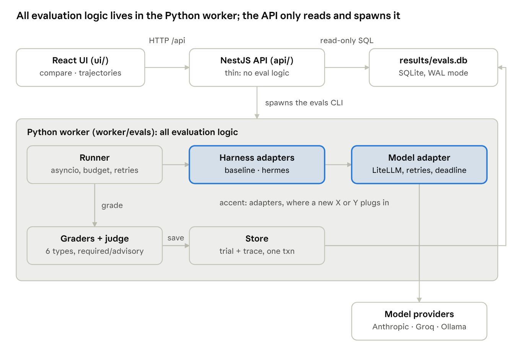
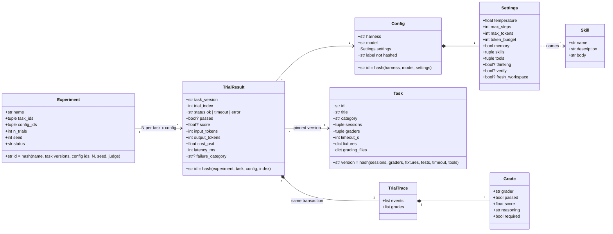

# Design

## Architecture



**Where the boundary is.** All evaluation logic lives in Python: config hashing, task versions, harnesses, grading, the runner, statistics and export. The API never re-implements any of it. It reads the database for lists and traces and shells out to the `evals` CLI for everything else. Config ids are content hashes, so computing them in two languages would be a bug waiting to happen. The cost is about 300 ms of process start-up per comparison request, which is fine for a tool like this.

**Why SQLite.** One file, no server, transactional, and both Python and Node can read it. WAL mode lets the UI read while a run is writing. Each trial and its trace are written in one transaction, so a crash can never leave a trial without its trace.

## Interfaces

```python
class Model(Protocol):                        # worker/evals/model.py
    async def complete(self, messages, tools, temperature, max_tokens) -> ModelResponse

class Harness(Protocol):                      # worker/evals/harness.py
    async def run(self, task, config, env: TrialEnv, trace: Trace) -> HarnessResult
```

- **Messages are plain OpenAI-format dicts.** LiteLLM, Groq, Ollama and Hermes all speak that format already. A message class of our own would only add translation code. The parsed output (`ToolCall`, `ModelResponse`) gets real types because the harness branches on it.
- **The runner owns the `Trace` and passes it into the harness.** If a trial times out or crashes, everything recorded up to that point is still saved. You can debug a timeout because you can see what the agent was doing when the clock ran out.
- **Cost is computed from tokens with one pricing function (`pricing.py`), for every harness.** Hermes calls the model itself, so a cost hook inside our model adapter would never see Hermes's spend. Both harnesses report tokens, and the same price table turns tokens into dollars, which keeps the cost numbers comparable.
- **Adding a model** is usually zero code, because any LiteLLM string works. **Adding a harness** is one class plus one line in the registry. The baseline is an in-process loop, and Hermes is a subprocess whose SQLite transcript we import. Two very different integration styles behind the same interface is evidence that the abstraction holds.

### The Hermes adapter

Hermes Agent, pinned to commit `0f602c5` (v0.23.3+984) and installed from source because Hermes no longer publishes wheels, runs one-shot (`hermes -z PROMPT --usage-file F`) with `HERMES_HOME` pointing at a fresh directory. With memory on, the sessions of a trial share one home. With memory off, each session gets its own home, which is deleted before the next session starts; otherwise Hermes's transcript store and logs let a later session read an earlier one. For each trial we:

- write a `config.yaml` that sets `agent.max_turns` from `max_steps`, `memory.memory_enabled` from the memory setting, and turns the user-profile feature off;
- copy only the config's skills into `$HERMES_HOME/skills`;
- choose toolsets: `file`, `terminal` and `code_execution`, plus `skills` when skills are on, plus `memory` and `session_search` when memory is on. `session_search` has to go when memory is off, otherwise Hermes can recall an earlier session through search and memory leaks back in through a side door;
- pass only the one provider key the model needs, not the rest of the environment;
- after each session, read `$HERMES_HOME/state.db` (Hermes's own transcript store) and convert every assistant message, tool call and tool result into our trace events. The usage file gives the tokens.

## Data model



| Entity | Identity | Notes |
|---|---|---|
| **Task** | `id`; `version` = hash of prompts, graders, fixtures, hidden tests, timeout and expected tools | Title and category edits don't change the version. Any change to what the agent sees or how it's graded does. |
| **Config** | `id` = hash of harness, model and settings (temperature, max steps, max tokens, token budget, memory, skills, tools, thinking) | The label is excluded, so renaming doesn't fork results. Skills and tools are sorted so order doesn't matter. Settings added later default to unset and unset settings are left out of the hash, so adding a setting never changes the ids of existing configs (a test pins a real pre-existing id). |
| **Experiment** | `id` = hash of name, task ids and versions, config ids, N and seed | Re-running the same request resumes it. A different seed starts an independent replicate. |
| **Trial** | `id` = hash of experiment, task, config and trial index | Status, pass/fail, score, tokens, cost, latency, error, failure category. A unique constraint plus `insert or ignore` makes saves idempotent. |
| **Trace** | one per trial | Events (session start, model responses with tool calls, tool results, memory reads and writes, skill loads, stops, errors, grading) and grades with reasoning. |

Trial statuses keep agent failures apart from our own failures:

- `ok`: the agent finished and was graded.
- `timeout`: the agent ran out of wall time, steps or token budget. **This counts as a failure.** Running out of budget is a property of the agent.
- `error`: infrastructure failed (the provider was down, rate limits outlasted every retry, a grader crashed). **These are excluded from the statistics and retried on resume.** Counting them as failures would punish a config for the provider's bad day.

The line between the two is a judgement call. A malformed tool call that Groq rejects with HTTP 400 is the model's fault, so the adapter turns it into a tool error fed back to the agent rather than an `error` trial. An early version got this wrong. It silently removed the model's own mistakes from the stats, and the first real run caught it (`e039cc2`).

## Isolation and reproducibility

- **Each trial gets a fresh temporary directory:** `work/`, seeded with the task fixtures, and `state/`, the harness's private state (baseline memory file, Hermes home). Both are deleted afterwards. Memory carries across the sessions of one trial and never across trials (`test_runner.py::test_runs_every_task_config_and_trial` asserts that each trial sees only its own fixtures).
- **Memory off means no persistence at all.** The work directory persists across the sessions of a trial, and with the memory tool removed agents use it as memory: Haiku wrote itself a notes file and read it back (experiment 11). Memory-off configs therefore set `fresh_workspace`, which restores the task's fixtures before every session after the first, in both harnesses. The UI sets it whenever memory is off.
- **Agent code runs in a subprocess** with the sandbox as working directory and HOME, a timeout, and an environment stripped of API keys. Paths in file tools can't escape the sandbox. This is isolation for correctness, not a security boundary (see known limits). Docker provides the outer boundary.
- **In Docker, agent code runs as a separate `agent` user.** Hermes, `run_python` and the hidden unit tests run via `sudo -u agent` with a clean environment. The app (`/app`, including tasks and results) isn't readable by that user, the trials directory can't be listed, and each trial directory is shared only between the worker and `agent`. Run on the host without Docker, everything runs as you and only the path checks apply.
- **Hidden tests are copied in at grading time,** into a copy of the work directory, so the agent can't read or edit them.
- **Reproducing a result:** the config id fixes harness, model and settings, the task version fixes the task, and the Hermes version is pinned. LLM sampling is still non-deterministic, which is why we run N trials and report intervals instead of single numbers.

## Graders

| Type | Used for | Design notes |
|---|---|---|
| `exact_match` | single answers | Takes the last `ANSWER:` line if there is one. Optional normalisation (trim, lower, strip quotes and markdown, strip punctuation, collapse whitespace) is applied to *both* sides. |
| `numeric` | computed values | Last number in the answer, thousands separators allowed, absolute tolerance. |
| `regex` | format and leak checks | Required patterns and forbidden patterns. |
| `file_state` | file tasks | JSON equality, line equality, exact content (also used to check an input file was *not* modified), regex, not-contains. The partial score is the fraction of checks passed. |
| `unit_tests` | coding tasks | Hidden `unittest` files run against a copy of the sandbox. The partial score is the fraction of tests passed, but pass/fail needs all of them. |
| `llm_judge` | writing tasks | Rubric plus optional reference answer. The judge also sees the task's input files. It must report a verdict per rubric item and a 1–5 score, as JSON. Responses are fenced as data with a prompt-injection warning. One retry on unparseable output, then the trial is an `error`, not a failure. |

**Combining graders:** a trial passes only when every *required* grader passes, and its score is the mean of the required scores. Advisory graders (`"required": false`) are recorded and shown, and a disagreement between them and the required graders is a failure category.

### How the graders were validated

1. **Every task's reference solution must pass, and its untouched fixtures must fail** (`tests/test_task_graders.py`, 50 cases). A grader that passes everything or fails everything is caught before it costs money.
2. **The judge is scored against 32 labelled responses** (`judge-validation/`), about 40% passes, built to be hard: near-misses on one rubric item, leaked hostnames, invented blockers, an over-length email and a prompt-injection attempt.

| Judge | Agreement | Cohen's κ | Too lenient | Too strict |
|---|---|---|---|---|
| claude-haiku-5-5, first version | 81% | 0.58 | 0 | 6 |
| claude-haiku-5-5, judge also sees the task's input files | **97%** | **0.93** | 0 | 1 |
| groq/qwen3.8-27b, same prompt (**the default judge**, used in the experiment) | **94%** | **0.87** | 1 | 1 |

**Repeat runs (experiment 14).** One validation run of a judge is a sample, not a measurement:

| Judge | κ per run | Verdict flips between runs |
|---|---|---|
| claude-sonnet-5-5 | 0.93, 0.93 | 0/32 |
| claude-haiku-5-5 | 0.87, 0.80, 0.93 | 3/32 |
| claude-opus-5-5 | 0.80, 0.80 | 0/32 (too strict on the same three items) |
| qwen3:8b (local, Ollama) | 0.69, 0.74 | 2/31, plus one empty reply (every error is too lenient) |

Sonnet 5.5 is the most accurate and the most stable, and it is what experiments 5–14 used. Qwen stays the default in code only because it's free; its 200k-tokens-a-day cap covers about one full experiment a day. Set `JUDGE_MODEL` to choose another.

Qwen is the default judge because it is free, from a different model family than the gpt-oss agents in the experiment (which avoids self-preference bias), and has its own rate-limit bucket. Haiku scored higher, but the Anthropic account had no credit during this build. The judge model is part of an experiment's id, and every grading event records it, so results graded by different judges are never mixed.

All six disagreements in the first version were the judge being *stricter* than the labels. Reading the reasoning showed why: the release-notes rubric says "no invented dates or versions", and the judge couldn't see `changes.json`, so it treated every date as possibly invented. Showing the judge the task's input files fixed it. The one remaining disagreement (incident-04 gives "yesterday" instead of the date) is a defensible judgement call.

**Caveat:** the labels were drafted by an AI assistant following the rubrics and still need a human pass (see `judge-validation/README.md`). Until then, κ measures agreement with the rubric's intent, not with people.

## Statistics

The unit of comparison is a **pair**: the same task and the same trial index under config A and config B. Infrastructure errors drop out, and a pair counts only when both sides finished.

- **Effect:** the mean over tasks of (B pass rate − A pass rate) per task. Weighting by task matters because tasks are what we want to generalise over.
- **Confidence interval:** a two-level paired bootstrap, 10,000 resamples, seeded. Resample tasks with replacement, then resample trial pairs within each task. Resampling only trials would pretend the 25 tasks are the whole universe and give intervals that are far too narrow.
- **Test:** an exact McNemar test (binomial on the discordant pairs) on trial pairs. It ignores the pairs where both configs agree, which is what makes it sensitive to real change.
- **Verdict:** "B is better" or "A is better" only when the CI excludes 0 *and* McNemar p < 0.05. If only one of the two agrees, the verdict says so and asks for more trials. Otherwise: **"no detectable difference (within noise)"**, together with the smallest difference this experiment *could* have detected (half the CI width). That turns "no difference" into a statement about statistical power, not a claim that the configs are equal.
- **Per-task deltas:** a Fisher exact test per task. Tasks where both configs always pass or always fail are flagged as ceiling or floor tasks, which carry no signal. The UI warns that with many tasks some per-task "real" results will be false positives. No multiple-comparison correction is applied, on purpose: the per-task view is for finding *where* to look, and the aggregate test is for deciding.
- **Cost, latency and tokens** are reported per config right next to the pass rate, so a +5 pp gain at 8× the cost is visible as a trade-off.

### Choosing N

- **N ≥ 3** so that each task has some within-task variance.
- **For a per-task verdict, N ≥ 5.** With N = 3 even a complete flip (0/3 → 3/3) only reaches Fisher p = 0.10. With N = 5 a complete flip gives p = 0.008, and 5/5 vs 1/5 gives p = 0.048. There's a test for exactly this (`test_one_task_flip_needs_five_trials_to_count`).
- **For the aggregate, more tasks beats more trials** once N ≥ 3. Most of the variance is *between* tasks, and the bootstrap resamples tasks.
- **Evidence from the overnight runs:** subsampling finished experiments (`analysis/trials_needed.py`) showed that N = 2 reproduced the N = 5 verdict in 10/10 subsets for both real effects (about ±20 pp), and never produced a false "better" for the A/A test. At N = 1 the verdict hedged ("tests disagree, run more trials") instead of claiming the wrong direction.
- **Local models at temperature 0 are deterministic.** qwen3:8b gave identical final answers on 25/25 tasks across 5 trials (experiment 12). Run N = 1 for them, or sample at a non-zero temperature if the question is about the distribution.
- **In practice:** run a cheap pilot at N = 2–3, drop ceiling and floor tasks, read the detectable difference the report prints, and only then decide whether a bigger run can answer the question.

## Failure categories

Failures (not errors) are classified from the trace, first match wins:

| Category | Rule |
|---|---|
| step exhaustion | hit `max_steps` or the token budget |
| timeout | hit the wall-clock limit |
| hallucinated tool | called a tool that doesn't exist |
| bad tool args | invalid or missing arguments, never recovered from |
| gave up early | no tool calls at all on a task that needs them |
| wrong tool | never used a tool the task requires (e.g. diagnosed the bug but never wrote the fix) |
| grader disagreement | graders on the same trial disagree (e.g. judge vs structural check) |
| wrong answer | everything else |

Hermes's tool names are mapped onto ours (`execute_code`/`terminal` count as `run_python`, `patch` counts as `write_file`).

## Budget, retries and partial failures

- **Retries:** the model adapter retries rate limits, timeouts and 5xx errors with exponential backoff and jitter, and waits at least as long as the provider's "try again in Ns" hint. It does not retry 4xx errors. Hermes does its own retries.
- **Deadlines:** every model call is wrapped in an asyncio deadline (request timeout + 10 s). litellm's own timeout didn't fire on some dropped connections, and five runs once sat on dead sockets until killed.
- **Provider hints can be long.** A daily cap answers with "try again in 10m", and the adapter obeys it, so a capped judge looks like a hang. Watch the log for `per day` limits.
- **Budget:** a hard cap per run. No new trial starts once agent plus judge spend reaches the cap. Trials already running finish, so the worst-case overshoot is (concurrency − 1) × the cost of one trial. A run stopped by the budget or with errors is marked `partial`. Run the same command again to resume it.
- **Trial ordering:** trials are scheduled by trial index, then task, then config. A run that stops early therefore leaves complete A/B pairs rather than "all of A, half of B".
- **Resume:** errored trials are deleted and re-run, and finished trials are skipped. If a task changed since the experiment started, resume refuses to continue, because mixing task versions in one comparison would be meaningless.

## Cost

```
cost per experiment ≈ tasks × trials × configs × (avg input tokens × input price + avg output tokens × output price)
                    + judged tasks × trials × configs × (judge tokens × judge price)
```

Prices come from LiteLLM's price table (list prices, even on free tiers). The measured token averages and the actual spend for the real experiment are in [EXPERIMENT.md](EXPERIMENT.md#cost). Ways to reduce cost:

- **Prompt caching:** Hermes's system prompt is about 11k tokens and is resent on every call, so provider prompt caching cuts most of its input cost.
- **Early stopping:** stop a comparison once the CI excludes 0 or is narrow enough to rule out the effect size you care about. It needs sequential-testing corrections to stay honest.
- **Sampling:** drop ceiling and floor tasks after a pilot, and spend trials where the configs disagree.
- **Cheaper judging:** judge only tasks that need it, and use a small validated judge model.

## Known limits

- **Task set size.** 25 tasks cannot detect small effects. The report prints the detectable difference for every comparison, so read "no difference" as "no difference larger than X".
- **Task difficulty.** Several tasks sit at the ceiling for strong models and carry no signal. The per-task table flags them.
- **Judge bias.** The judge is validated on 32 AI-drafted labels, not human ones. An LLM judge from the same family as the agent may favour its own style. Use a judge from another provider (the default judge is not the experiment's agent model). Experiments 5–14 used Sonnet 5.5 to judge Haiku and Sonnet agents, which is the same family. The skills result agreed with the Groq-judged run (+21.6 vs +19.2 pp), but same-family preference wasn't measured separately.
- **Contamination.** Roman numerals, binary search, primes and slugify are textbook problems that are probably in training data, so they test recall as much as agent skill. The ACME skill tasks and their conventions were invented for this set and are contamination-free.
- **Harness quirks.**
  - Hermes ignores our `temperature`, `max_tokens` and `thinking` settings (there is no per-run setting for them). The `thinking` switch is currently applied only to Ollama models.
  - Hermes uses about 10× the input tokens of the baseline because of its large system prompt.
  - Hermes's tools can reach outside the sandbox directory. Run it inside Docker.
  - Hermes guesses the Anthropic auth mode from the key prefix. Release 0.19.0 treated anything but `sk-ant-api…` as a Claude Code subscription token; the pinned commit also accepts the newer `sk-ant-usr/svc/admin` Console keys. The adapter refuses other key types up front.
  - Hermes refuses to run as root in a container, so the image runs everything as the unprivileged `node` user.
  - The pinned Hermes installs provider SDKs on first use, per home directory. Since every trial gets a fresh home, the SDKs (`anthropic`, `google` extras) are installed into Hermes's own environment instead.
  - Hermes's token counts include cache reads, which we price at the full input rate, so its cost is an upper bound.
- **The judge doesn't see skills.** It sees the task and its input files, but not the skills the agent loaded, so skill-derived content can look invented (experiment 8).
- **Thinking flags aren't always honoured.** `qwen3:30b-a3b` on Ollama ignores `think: false` and writes its reasoning into the answer. Check output token counts, not just the config.
- **Price table.** LiteLLM fetches its price map from GitHub at startup and falls back to a bundled copy, so a cost can change without a code change. Set `LITELLM_LOCAL_MODEL_COST_MAP=True` to pin it. Hermes cost is priced on a session's summed tokens, so a session over 100k tokens would get Haiku's 5× long-context rate.
- **Sandboxing.** Agent code runs as a subprocess without a seccomp or container boundary per trial. That's fine on a laptop or in the compose container, but not for untrusted tasks.
- **Rate limits.** Free tiers (Groq at 8k tokens per minute and 200k per day, Gemini at 5 requests per minute) shape what can be run. Hermes can't run on Groq's free tier at all, because a single request exceeds the per-minute token limit. Rate-limited trials are `error`, not failures, but a config that hits limits more often is under-sampled until it is resumed.
- **Rate-limit timeouts are coarse.** A trial that times out after *any* wait on a 429 or 503 from the provider is an infrastructure error, not an agent failure. A better rule would compare the wait with the timeout. Request timeouts used to count as rate-limit waits, so a slow model's trials were excluded instead of failed; see experiment 3.
- **Latency depends on what else is running.** Experiments 2 and 3 ran at the same time on one laptop, so their latencies are comparable within each experiment but not across them.
- **Local models run with thinking off.** With thinking on, qwen3:8b was too slow for the task timeouts on a laptop. It's a versioned setting, so a thinking-on run would be a separate config.
- **Statistics.** McNemar treats trial pairs as independent, but trials of the same task are correlated, so its p-value is optimistic. For a deterministic model the trials are exact copies, which is the extreme case. That's why the verdict also requires the task-level bootstrap CI to exclude 0.
- **Memory tasks** test recall within a trial across sessions. They don't test long-horizon memory quality or memory pollution.
- **SQLite across Docker's VM boundary.** WAL needs shared memory between readers and writers, so a worker on the host and the API in a container must not share one live database. Within one container, or entirely on the host, it's fine. A server database (Postgres) would remove this limit, and the store is one small class.
- **Single machine.** The runner is a single process (asyncio). Concurrency is limited by provider limits long before CPU.

## Assumptions

- **"Versioned configs"** means content-addressed: the same settings always give the same id, and any change gives a new one. There is no mutable "v2 of config X".
- **"Isolated unless memory says so"** means memory persists across the sessions of one trial, never across trials. With memory off, nothing persists between sessions, the work directory included.
- **Running out of steps, tokens or time is the agent's failure. Infrastructure trouble is not.**
- **A multi-session task is graded on the final session's answer and the final sandbox state.**
- **Skills are made available, not forced.** The agent sees names and descriptions and loads the full text on demand, the same way Hermes does it.
- **List prices are used for cost even on free tiers,** so the formula reflects what the run would cost on a paid plan.
- **The UI is React instead of Vue** (see the README).
